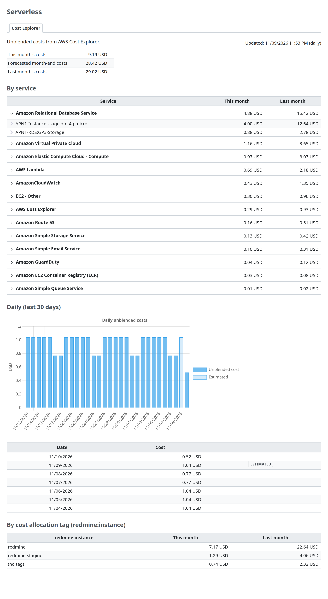

# Redmine Serverless Cost Explorer

Redmine Serverless Cost Explorer (`redmine_serverless_costexplorer`) is a Redmine plugin that shows the costs of the AWS account in Redmine's administration, from AWS Cost Explorer. It adds the "Cost Explorer" tab to the shared "Serverless" administration menu. It does not modify Redmine's own files. The plugin is in early development.

- [Setup](setup.md): requirements, installation, configuration, AWS resources, network, tests
- [IAM permissions](iam.md): permissions, example policy, resource-based policies

The plugin assumes that the AWS account is used only for the Redmine, so the account's costs are the Redmine's costs. For an account that holds several Redmine servers, the costs can also be split by a cost allocation tag (an option, off by default).

## Features

Each feature has a condition that enables it. Without `REDMINE_COSTEXPLORER_ENABLED=true`, the plugin makes no requests to AWS.

| Feature | Contents | Enabled when | Page |
| --- | --- | --- | --- |
| The "Cost Explorer" tab | The costs of the AWS account: the total (this month, month-end forecast, last month), by service (with usage types), and daily for the last 30 days (chart and table) | `REDMINE_COSTEXPLORER_ENABLED=true`; administrators | [What the tab shows](#what-the-tab-shows) |
| Daily fetch | The rake task `redmine_serverless_costexplorer:refresh` fetches the costs once a day and keeps them in the database | Same as above; run daily by a schedule | [setup.md](setup.md#schedule) |
| Costs by tag | The costs of this month and the previous month by the values of a cost allocation tag (normally `redmine:instance`) | `REDMINE_COSTEXPLORER_TAG_KEY` is set (off by default) | [Costs by tag](#costs-by-tag-optional) |

## What the tab shows

The costs of the whole account. All amounts are AWS Cost Explorer's unblended costs (`UnblendedCost`). The top right shows "Updated: `<time>` (daily)", and each section is a heading and a list, as in the rest of the tab. The first section is "Total", a list with the columns "This month", "Month-end forecast" and "Last month".

| Section | Contents | Cost Explorer request |
| --- | --- | --- |
| Total: "This month" | The month's costs until today, including today's costs so far | `GetCostAndUsage`, monthly, by service and usage type, from the first day of the previous month to tomorrow (the total) |
| Total: "Month-end forecast" | The costs until yesterday plus Cost Explorer's forecast from today to the end of the month. When Cost Explorer has no forecast (for example, in an account with too little history), "No forecast (`<reason>`)" in its cell | `GetCostForecast`, from today to the first day of next month |
| Total: "Last month" | The previous month's costs, with an "Estimated" badge before the amount while Cost Explorer has not finalized them | Same request as "This month" |
| By service | Each service's costs this month and last month, the largest this month first. Each service row expands to its usage types (`USAGE_TYPE`); the rows start collapsed and open with the arrow on the left, like Redmine's grouped lists (also with the keyboard) | Same request (`GroupBy` `SERVICE` and `USAGE_TYPE`) |
| Daily (last 30 days) | A bar chart of the daily unblended costs, and a table of the same values under it. Past days that Cost Explorer has not finalized have an "Estimated" badge (a lighter bar in the chart) | `GetCostAndUsage`, daily, from 29 days ago (or the first day of the month, if earlier) to tomorrow |
| By cost allocation tag (`<tag>`) | Only with `REDMINE_COSTEXPLORER_TAG_KEY`: each tag value's costs this month and last month, with "(no tag)" for the costs without it | `GetCostAndUsage`, monthly, by the tag |

- **Amounts:** Unblended costs (`UnblendedCost`), in the currency that Cost Explorer returns (USD), with two decimals ("8.22 USD"), right-aligned. Redmine right-aligns only hour columns, so a small CSS file of the plugin right-aligns the amount columns.
- **Estimated:** Cost Explorer marks periods it has not finalized as `Estimated`. The page shows the "Estimated" badge only on closed periods (last month, days before today). This month and today are never final yet, so they have no badge.
- **Chart:** Redmine's own Chart.js (`chart.js` in its importmap), loaded lazily from a Stimulus controller as Redmine's charts (such as the repository statistics) do. No JavaScript library is added. The chart shows the same values as the table under it.
- **Dates:** Cost Explorer's dates are in UTC, so "today" is today in UTC.
- **The fetch time:** The top right shows when the data was fetched. Cost Explorer updates its data about once a day, so data a day old is normal.
- **Errors:** When the last fetch failed, the page shows "Fetch error: `<time>` (`<error class>`)" above the last successful data. When Cost Explorer could not be reached (no route from the network, DNS or a timeout), it also says that a network without internet access needs a route to it ([setup.md](setup.md#network)).

### Terms

The screen uses the Japanese terms of the Cost Explorer documentation (checked on 2026-11-10).

| Screen (en / ja) | AWS term | Source |
| --- | --- | --- |
| Unblended cost / 非ブレンドコスト | `UnblendedCost` | https://docs.aws.amazon.com/ja_jp/cost-management/latest/userguide/ce-exploring-data.html |
| Daily unblended costs / 日別の非ブレンドコスト | Same | Same |
| Month-end forecast / 月末の予測 | A shorter form of 「月末の予測コスト」 on the same page | Same |
| Estimated / 推定 | 「過去 1 か月の推定コスト」 on the same page | Same |
| Service, Usage types, Cost allocation tag / サービス、使用タイプ、コスト配分タグ | `SERVICE`, `USAGE_TYPE`, tags | https://docs.aws.amazon.com/ja_jp/cost-management/latest/userguide/ce-filtering.html |
| (no tag) / (タグなし) | Costs without the tag | The plugin's own term; to recheck in the console |

## Fetching the costs

The page never calls Cost Explorer. AWS charges each Cost Explorer API request (USD 0.01 per request, AWS Cost Explorer pricing page, checked on 2026-11-10), and Cost Explorer updates its data about once a day, so the plugin fetches the costs once a day and keeps them.

| How | When | Runs in |
| --- | --- | --- |
| Rake task `redmine_serverless_costexplorer:refresh` | Once a day, from a schedule ([setup.md](setup.md#schedule)) | The process that runs the task. It fetches at once and fails (non-zero exit) when the fetch fails |

- **The only fetch:** There is no fetch from the page and no button: the daily run is the only one, so the cost of the requests stays fixed.
- **Requests per fetch:** 3 (`GetCostAndUsage` twice, `GetCostForecast` once), or 4 with the tag. A long answer of `GetCostAndUsage` comes in pages, and each further page is one more request.
- **Requests in a month:** 3 or 4 a day: about 90 to 120 a month, about USD 0.9 to 1.2.
- **A failed fetch:** It is recorded with its error, shown on the tab above the last successful data, and the task fails. The next day's run fetches again.
- **Snapshots:** Each fetch is a row in `serverless_costexplorer_snapshots`: when it was started and by whom (`schedule`), when it was fetched, the data (JSON), the error, and the number of requests. The rake task deletes rows older than 90 days after each successful fetch, keeping the latest successful one.

## Costs by tag (optional)

For an AWS account that holds several Redmine servers, the costs can be split by a cost allocation tag. It is off by default: without `REDMINE_COSTEXPLORER_TAG_KEY`, the plugin does not request the tag grouping and the page has no tag section.

- **Turning it on:** Set `REDMINE_COSTEXPLORER_TAG_KEY` to the tag key, normally `redmine:instance` (the tag that [Serverless](https://redmine-kit.github.io/serverless/) puts on each instance's resources). In Serverless, the deployment configuration file sets it.
- **Activating the tag:** In the Billing and Cost Management console, activate the tag key as a cost allocation tag (Cost allocation tags). AWS takes up to 24 hours to activate it. Until costs carry the tag, the page says so and shows how to activate it.
- **One more request:** A fetch makes 4 requests instead of 3.
- **Untagged costs:** Costs without the tag (for example, shared resources or costs from before the activation) are shown as "(no tag)".

## Notes

- **AWS Organizations:** In a member account, the management account decides whether member accounts may use Cost Explorer (Cost Management preferences › "Linked account access"; AWS Cost Management User Guide, "Controlling access to Cost Explorer", checked on 2026-11-10). Without it, the requests fail with an access error. A member account sees only its own costs.
- **Enabling Cost Explorer:** Cost Explorer is enabled for an account by opening it once in the console; AWS then prepares the data, which can take up to 24 hours (AWS Cost Management User Guide, "Enabling Cost Explorer", checked on 2026-11-10).
- **No connection test:** The plugin does not add a connection test to Redmine Serverless's "Status" tab: each test would be a charged request. The "Cost Explorer" tab shows the result of the last fetch.
- **Code structure:** `lib/redmine_serverless_costexplorer/fetcher.rb` makes the requests, `app/models/serverless_costexplorer_snapshot.rb` keeps the fetches, `lib/tasks/redmine_serverless_costexplorer.rake` runs them, and `app/controllers/serverless_costexplorer_controller.rb` shows the tab. `init.rb` registers the tab.
- **Migrations:** A table for the snapshots (`serverless_costexplorer_snapshots`). Run `redmine:plugins:migrate`.

## Sponsors

<Sponsors><a href="https://localstack.cloud">LocalStack</a></Sponsors>

## License

Redmine Serverless Cost Explorer is released under the GNU General Public License, version 2 or (at your option) any later version. See [LICENSE](../LICENSE). An unofficial Redmine plugin.
