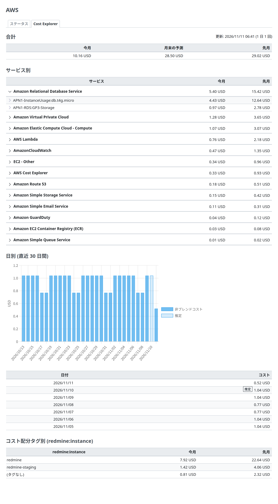

# Redmine Serverless Cost Explorer

Redmine Serverless Cost Explorer(`redmine_serverless_costexplorer`)は、AWS アカウントの費用を、AWS Cost Explorer から Redmine の管理画面に表示する Redmine のプラグインです。共通の「Serverless」の管理メニューに、「Cost Explorer」のタブを追加します。Redmine そのもののファイルは変えません。開発の初期です(バージョン 0.1.2)。

- [準備](setup.md): 必要なもの、インストール、設定、AWS リソース、ネットワーク、テスト
- [IAM 権限](iam.md): 権限、ポリシーの例、リソースベースのポリシー

このプラグインは、AWS アカウントを Redmine だけに使う前提です。アカウントの費用が、そのまま Redmine の費用です。複数の Redmine を置くアカウントのために、コスト配分タグごとにも分けられます(オプション。既定は無効)。

## 機能

機能ごとに、有効になる条件があります。`REDMINE_COSTEXPLORER_ENABLED=true` がなければ、プラグインは AWS に要求を送りません。

| 機能 | 内容 | 有効になる条件 | ページ |
| --- | --- | --- | --- |
| 「Cost Explorer」のタブ | AWS アカウントのコスト。今月のコスト、月末の予測コスト、先月のコスト、サービス別(使用タイプの明細)、日別(直近30日間のグラフと表) | `REDMINE_COSTEXPLORER_ENABLED=true`。管理者 | [タブに表示するもの](#what-the-tab-shows) |
| 毎日の取得 | rake のタスク `redmine_serverless_costexplorer:refresh` が、1 日に 1 回費用を取得し、データベースに保存する | 同上。スケジュールで毎日実行する | [setup.md](setup.md#schedule) |
| タグ別の費用 | コスト配分タグ(ふつうは `redmine:instance`)の値別の、今月と先月のコスト | `REDMINE_COSTEXPLORER_TAG_KEY` がある(既定は無効) | [タグ別の費用](#costs-by-tag-optional) |

## タブに表示するもの

アカウント全体のコストです。見出しは置かず、説明の行と、右側の「更新: <日時>(1 日 1 回)」から始めます。

| 欄 | 内容 | Cost Explorer への要求 |
| --- | --- | --- |
| 今月のコスト | 今月の、今日までのコスト。今日のこれまでのコストを含む | `GetCostAndUsage`。月別、サービスと使用タイプ別。先月の 1 日から明日まで(合計) |
| 月末の予測コスト | 昨日までのコストと、Cost Explorer の今日から月末までの予測の合計。Cost Explorer に予測がないとき(たとえば、履歴の短いアカウント)は「予測なし(<理由>)」 | `GetCostForecast`。今日から来月の 1 日まで |
| 先月のコスト | 先月のコスト。Cost Explorer が確定していないときは「推定」のバッジ | 「今月のコスト」と同じ要求 |
| サービス別 | サービス別の今月と先月のコスト。今月の多い順。各サービスの行は、使用タイプ(`USAGE_TYPE`)の明細を開ける。明細は最初は閉じていて、Redmine のグループ表示と同じく、行の左の矢印で開く(キーボードでも開ける) | 同じ要求(`GroupBy` に `SERVICE` と `USAGE_TYPE`) |
| 日別(直近30日間) | 日別の非ブレンドコストの棒グラフと、その下に同じ値の表。Cost Explorer が確定していない過去の日には「推定」のバッジ(グラフでは薄い色) | `GetCostAndUsage`。日別。29 日前(月の 1 日のほうが前なら、その日)から明日まで |
| コスト配分タグ別(<タグ>) | `REDMINE_COSTEXPLORER_TAG_KEY` があるときだけ。タグの値別の今月と先月のコスト。タグのないコストは「(タグなし)」 | `GetCostAndUsage`。月別、タグ別 |

- **金額:** 非ブレンドコスト(`UnblendedCost`)です。通貨は Cost Explorer が返すもの(USD)で、「8.22 USD」のように小数 2 桁で、右寄せで表示します。Redmine が右寄せにするのは時間の列だけなので、プラグインの小さな CSS で金額の列を右寄せにします。
- **推定:** Cost Explorer は、確定していない期間に `Estimated` を付けます。画面では、終わった期間(先月、今日より前の日)に付いているときだけ「推定」のバッジを出します。今月と今日は、まだ終わっていないので、いつも確定していません。バッジは付けません。
- **グラフ:** Redmine の Chart.js(importmap の `chart.js`)を、Redmine のグラフ(リポジトリの統計など)と同じく、Stimulus のコントローラーから必要なときに読み込みます。新しい JavaScript のライブラリは追加しません。グラフの値は、下の表と同じです。
- **日付:** Cost Explorer の日付は UTC です。「今日」は UTC の今日です。
- **取得の日時:** 右上に、データを取得した日時を表示します。Cost Explorer のデータは、およそ 1 日に 1 回更新されるので、1 日前のデータはふつうです。
- **エラー:** 最後の取得が失敗したときは、最後に成功したデータの上に「取得エラー: <日時>(<エラーのクラス>)」を表示します。Cost Explorer につながらなかったとき(ネットワークの経路がない、DNS、タイムアウト)は、インターネットにつながらないネットワークには経路が必要なことも表示します([setup.md](setup.md#network))。

### 用語

画面の語は、Cost Explorer の AWS のドキュメントの日本語に合わせています(2026-11-10 に確認)。

| 画面(ja / en) | AWS の語 | 出典 |
| --- | --- | --- |
| 非ブレンドコスト / Unblended cost | `UnblendedCost` | https://docs.aws.amazon.com/ja_jp/cost-management/latest/userguide/ce-exploring-data.html |
| 日別の非ブレンドコスト / Daily unblended costs | 同上 | 同上 |
| 月末の予測コスト / Forecasted month-end costs | 同上(「月末の予測コスト」) | 同上 |
| 今月のコスト / This month's costs | 同上の「今月の初めから今日までのコスト」を短くしたもの | 同上 |
| 推定 / Estimated | 同上の「過去 1 か月の推定コスト」 | 同上 |
| サービス、使用タイプ、コスト配分タグ / Service, Usage types, Cost allocation tag | `SERVICE`、`USAGE_TYPE`、タグ | https://docs.aws.amazon.com/ja_jp/cost-management/latest/userguide/ce-filtering.html |
| (タグなし) / (no tag) | タグのないコスト | 当プラグインの語。コンソールの表示は要確認 |

## 費用の取得

画面は Cost Explorer を呼びません。AWS は Cost Explorer の API の要求ごとに課金し(1 要求 0.01 USD。AWS Cost Explorer の料金のページ。2026-11-10 に確認)、Cost Explorer のデータの更新はおよそ 1 日に 1 回なので、プラグインは 1 日に 1 回費用を取得して保存します。

| 方法 | タイミング | 動く場所 |
| --- | --- | --- |
| rake のタスク `redmine_serverless_costexplorer:refresh` | 1 日に 1 回、スケジュールから([setup.md](setup.md#schedule)) | タスクを実行するプロセス。その場で取得し、失敗すると、タスクも失敗する(0 以外の終了コード) |

- **取得はこれだけ:** 画面からの取得やボタンはありません。毎日の実行だけなので、要求の費用は一定です。
- **1 回の取得の要求の数:** 3 件(`GetCostAndUsage` が 2 件、`GetCostForecast` が 1 件)、タグありで 4 件です。`GetCostAndUsage` の長い応答は複数のページに分かれ、次のページごとに 1 件増えます。
- **1 か月の要求の数:** 1 日 3 件か 4 件で、1 か月におよそ 90 件から 120 件、約 0.9 から 1.2 USD です。
- **失敗した取得:** エラーといっしょに記録し、タブでは最後に成功したデータの上に表示し、タスクも失敗します。次の日の実行で、また取得します。
- **スナップショット:** 取得ごとに、`serverless_costexplorer_snapshots` に 1 行を作ります。始めた日時と始めたもの(`schedule`)、取得した日時、データ(JSON)、エラー、要求の数です。rake のタスクは、取得が成功するたびに、90 日より古い行を消します。最後に成功した行は残します。

## タグ別の費用(オプション)

複数の Redmine を置く AWS アカウントでは、コスト配分タグで費用を分けられます。既定は無効です。`REDMINE_COSTEXPLORER_TAG_KEY` がなければ、タグごとの要求を送らず、画面にもタグの欄を出しません。

- **有効にする:** `REDMINE_COSTEXPLORER_TAG_KEY` に、タグのキーを設定します。ふつうは `redmine:instance` です([Serverless](https://redmine-kit.github.io/serverless/ja/) が、Redmine ごとのリソースに付けるタグです)。Serverless では、デプロイの設定ファイルで設定します。
- **タグを有効にする:** Billing and Cost Management のコンソール(コスト配分タグ)で、タグのキーをコスト配分タグとして有効にします。有効になるまで、最大で 24 時間かかります。タグの付いた費用がまだないあいだは、画面にそう表示し、有効にする方法を示します。
- **要求が 1 件増える:** 1 回の取得が 3 件から 4 件になります。
- **タグのない費用:** タグのない費用(たとえば、共有のリソースや、有効にする前の費用)は「(タグなし)」として表示します。

## 補足

- **AWS Organizations:** メンバーアカウントでは、管理アカウントが、メンバーアカウントに Cost Explorer を許すかを決めます(コスト管理の設定 ›「Linked account access」。AWS Cost Management ユーザーガイドの「Controlling access to Cost Explorer」。2026-11-10 に確認)。許していなければ、要求はアクセスのエラーで失敗します。メンバーアカウントで見えるのは、そのアカウントの費用だけです。
- **Cost Explorer を有効にする:** Cost Explorer は、コンソールで一度開くと、そのアカウントで有効になります。そのあと AWS がデータを準備し、最大で 24 時間かかります(AWS Cost Management ユーザーガイドの「Enabling Cost Explorer」。2026-11-10 に確認)。
- **接続テストはない:** Redmine Serverless の「ステータス」のタブには、接続テストを追加しません。テストのたびに、課金される要求になるためです。最後の取得の結果は、「Cost Explorer」のタブに表示します。
- **コードの構成:** `lib/redmine_serverless_costexplorer/fetcher.rb` が要求を送り、`app/models/serverless_costexplorer_snapshot.rb` が取得を保存し、`lib/tasks/redmine_serverless_costexplorer.rake` が取得を実行し、`app/controllers/serverless_costexplorer_controller.rb` がタブを表示します。`init.rb` がタブを登録します。
- **マイグレーション:** スナップショットの表(`serverless_costexplorer_snapshots`)を作ります。`redmine:plugins:migrate` を実行します。

## スポンサー

<Sponsors><a href="https://localstack.cloud">LocalStack</a></Sponsors>

## ライセンス

Redmine Serverless Cost Explorer は、GNU General Public License バージョン 2 またはそれ以降のバージョンで公開しています。[LICENSE](../../LICENSE) を参照してください。Redmine の非公式のプラグインです。
